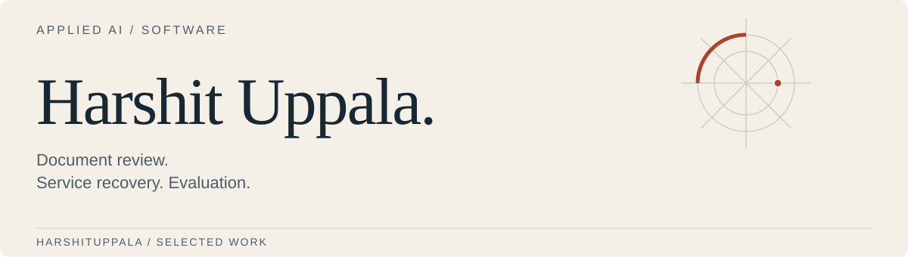

<picture>
  <source media="(max-width: 520px) and (prefers-color-scheme: dark)" srcset="assets/profile-dark-mobile.svg">
  <source media="(max-width: 520px)" srcset="assets/profile-light-mobile.svg">
  <source media="(prefers-color-scheme: dark)" srcset="assets/profile-dark.svg">
  
</picture>

# Hi, I’m Harshit.

I’m a computer science student at Memorial University of Newfoundland, graduating in December 2026. I build tools for document review, AI evaluation and service recovery.

[Portfolio](https://harshit-uppala-portfolio.vercel.app) · [LinkedIn](https://www.linkedin.com/in/harshit-kumar-uppala-8b65271a5)

## What I’m building

### [ATLAS + CHAOSLAB](https://github.com/harshituppala/atlas-chaoslab)

An RFP asks for recovery within four hours. The capability register promises eight. **ATLAS** puts the requirement and source passage beside the assessment so a reviewer can check the mismatch.

**CHAOSLAB** tests the workflow’s outputs: what it extracted, which evidence it cited, and what happened when a tool failed. It also compares saved runs, keeping regressions and missing cases visible.

[Open the review lab](https://atlas-review-lab.onrender.com) · [Read the case study](https://github.com/harshituppala/atlas-chaoslab/blob/main/docs/case-study.md)

### [IncidentDesk](https://github.com/harshituppala/incidentdesk)

A checkout service is failing. Inspect the traces, review a recovery proposal, then approve or reject it. New HTTP requests check whether the change helped; an approval stops being valid when the service state changes.

The hosted lab follows deterministic rules. Separate local experiments compare a model with those rules, including cases where the model does worse.

[Open the recovery lab](https://incidentdesk-g6pp.onrender.com) · [Read the design and results](https://github.com/harshituppala/incidentdesk/blob/main/docs/case-study.md)

Both demos use fictional data. They run on free hosting, so the first visit can be slow. Setup instructions, test reports and remaining work are in each repository.

## Cloud work

I’ve earned **AWS Certified Cloud Practitioner** and am preparing for **Solutions Architect – Associate**.

In ATLAS, I’ve tested an optional Amazon Bedrock path for document assessment. The [validation notes](https://github.com/harshituppala/atlas-chaoslab/blob/main/docs/bedrock-live-validation.md) include the model’s mistakes as well as its results. The public demo uses an offline baseline; it is not an AWS-hosted application.

The projects also cover Docker packaging, PostgreSQL access controls, CI checks and a [backup-and-restore drill](https://github.com/harshituppala/atlas-chaoslab/blob/main/docs/adr/023-logical-backup-restore-drill.md). The demos currently run on Render, and the portfolio runs on Vercel.

## Tools in these projects

Python and FastAPI for services; React and TypeScript for the interfaces; SQL and PostgreSQL for persistence. Docker, pytest and browser tests cover packaging and checks. The READMEs explain where each tool fits.
