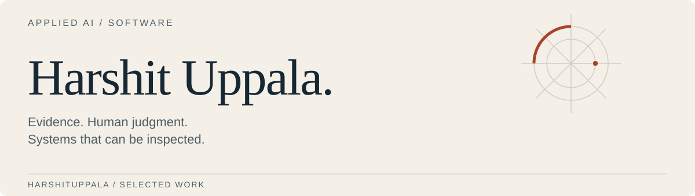

<picture>
  <source media="(max-width: 520px) and (prefers-color-scheme: dark)" srcset="assets/masthead-dark-mobile.svg">
  <source media="(max-width: 520px)" srcset="assets/masthead-light-mobile.svg">
  <source media="(prefers-color-scheme: dark)" srcset="assets/masthead-dark.svg">
  
</picture>

# Harshit Uppala

Computer science student at Memorial University of Newfoundland, building applied AI tools and backend systems.

My current projects focus on workflows where an answer needs evidence, a reviewer and a way to detect failure.

[Portfolio](https://harshit-uppala-portfolio.vercel.app) · [LinkedIn](https://www.linkedin.com/in/harshit-kumar-uppala-8b65271a5)

## Selected work

### [ATLAS and CHAOSLAB](https://github.com/harshituppala/atlas-chaoslab)

ATLAS compares procurement requirements with capability records and links findings to source passages. CHAOSLAB tests extraction, citations, review state and failure handling, retaining incorrect outputs in its reports.

[Try the fictional review lab](https://atlas-review-lab.onrender.com) · [Case study](https://github.com/harshituppala/atlas-chaoslab/blob/main/docs/case-study.md)

### [IncidentDesk](https://github.com/harshituppala/incidentdesk)

Investigate a checkout failure, review a bounded recovery proposal and approve a change. Fresh HTTP traffic checks the outcome; stale approvals and unsupported actions are blocked. Local model experiments are compared with explicit rules, including cases where the model performs worse.

[Try the recovery lab](https://incidentdesk-g6pp.onrender.com) · [Design and results](https://github.com/harshituppala/incidentdesk/blob/main/docs/case-study.md)

Both hosted labs use synthetic data and deterministic baselines. Their repositories separate those demos from model experiments and document what remains unfinished. Free hosting may take a minute to wake up.

## Working with

Python, TypeScript/JavaScript, HTTP APIs, SQL, Docker, evaluation fixtures and browser tests. The project READMEs include setup instructions, architecture decisions and retained failures.
